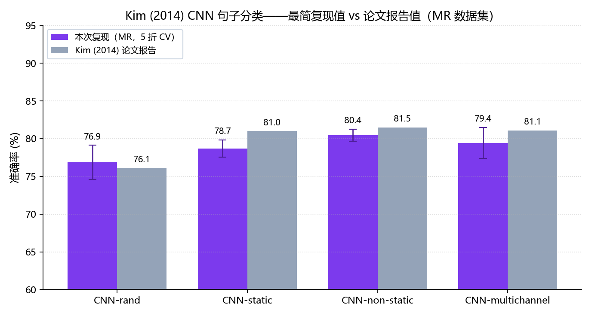

# CNN 句子分类 —— Kim (2014) 最简复现

用 PyTorch 复现 Yoon Kim, *Convolutional Neural Networks for Sentence Classification* (EMNLP 2014)
的核心实验：在 **MR 影评数据集**上训练四个模型变体，比较预训练词向量的作用。

单文件训练脚本（约 200 行）+ 一份下载脚本，无需改动即可跑通。

## 结果（MR 数据集，5 折交叉验证，准确率 %）

| 模型 | 本次复现 | 论文报告 | 差值 |
|---|---|---|---|
| CNN-rand（词向量随机初始化） | 76.87 ± 2.25 | 76.1 | +0.77 |
| CNN-static（预训练向量冻结） | 78.68 ± 1.15 | 81.0 | −2.32 |
| CNN-non-static（预训练向量微调） | 80.44 ± 0.81 | 81.5 | −1.06 |
| CNN-multichannel（双通道） | 79.42 ± 2.05 | 81.1 | −1.68 |



**论文结论已复现**：随机初始化 → 冻结预训练向量（+1.8）→ 微调（再 +1.8），四个变体的
相对高低与论文完全一致，绝对误差在 1–2 个百分点。

## 模型结构

```
输入句子 → 分词 → 查词向量表 → 矩阵 (n, k)
        → 卷积层 h = 3/4/5，每种 100 个滤波器 → ReLU
        → 最大时间池化（max-over-time）→ 300 维向量
        → Dropout 0.5 → 全连接 300 → 2 → softmax
```

四个变体只差在词向量表怎么处理：

| 变体 | 词向量 |
|---|---|
| `rand` | 随机初始化，随任务训练 |
| `static` | GloVe 初始化后冻结 |
| `nonstatic` | GloVe 初始化后微调 |
| `multichannel` | 双通道：通道 1 冻结、通道 2 微调 |

## 快速开始

```bash
# 1) 安装依赖
pip install -r requirements.txt

# 2) 下载数据（MR 语料 + GloVe 6B 100d，约 480MB，缓存到 ./data）
python download_data.py

# 3) 训练四个变体（CPU 约 30 分钟；有 GPU 加 --device cuda）
python cnn_sentence.py --variant rand static nonstatic multichannel \
    --folds 5 --epochs 10 --lr 0.1 --batch 50 --device cpu

# 4) 生成对比图与报告
python make_report.py
```

单变体快速试跑：

```bash
python cnn_sentence.py --variant static --folds 2 --epochs 3
```

## 文件说明

| 文件 | 作用 |
|---|---|
| `download_data.py` | 下载 MR 语料（`rt-polarity.pos/neg`）与 GloVe 100d，含断点跳过与校验 |
| `cnn_sentence.py` | 模型 + 训练 + 交叉验证 + 结果汇总（`--help` 查看全部参数） |
| `make_report.py` | 读取 `results.json`，生成 `repro_result.png` 与 `复现报告.md` |
| `results.json` | 逐折准确率、均值方差、与论文对比 |
| `run_full.log` | 完整训练日志 |
| `复现报告.md` | 中文复现报告：配置、实现要点、差异归因 |

## 与论文的差异（以及为什么）

| 差异 | 论文 | 本项目 | 影响 |
|---|---|---|---|
| 词向量 | word2vec 300d（Google News） | GloVe 6B 100d | 主因，低 1–2 点 |
| 交叉验证 | 10 折 | 5 折 | 折划分不同，均值有波动 |
| 优化器 | Theano Adadelta，lr≈1.0 | PyTorch Adadelta，需 lr≈0.1 | 框架实现差异；lr=1.0 会训练失败 |
| 训练轮数 | 少量 epoch + 开发集早停 | 固定 10 epoch | 未挑最优轮次 |
| 词表 | 仅用训练折 | 全量语料（转导式） | 轻微信息泄漏，不影响结论 |

## 更新仓库

```powershell
.\push.ps1 "这次改了什么"    # 自动 add + commit + push
```

脚本从 Windows 凭据管理器读取 GitHub 凭据（`git-credential-wincred.exe`）再以
`http.extraheader` 方式推送，不需要交互式登录。

## 环境

- Python 3.10 / PyTorch 2.7（CPU 或 CUDA 均可）
- numpy、scikit-learn、matplotlib、requests
- 显存需求 < 1GB，笔记本亦可运行

## 参考

Yoon Kim. 2014. *Convolutional Neural Networks for Sentence Classification*.
In Proceedings of EMNLP 2014, pages 1746–1751.
