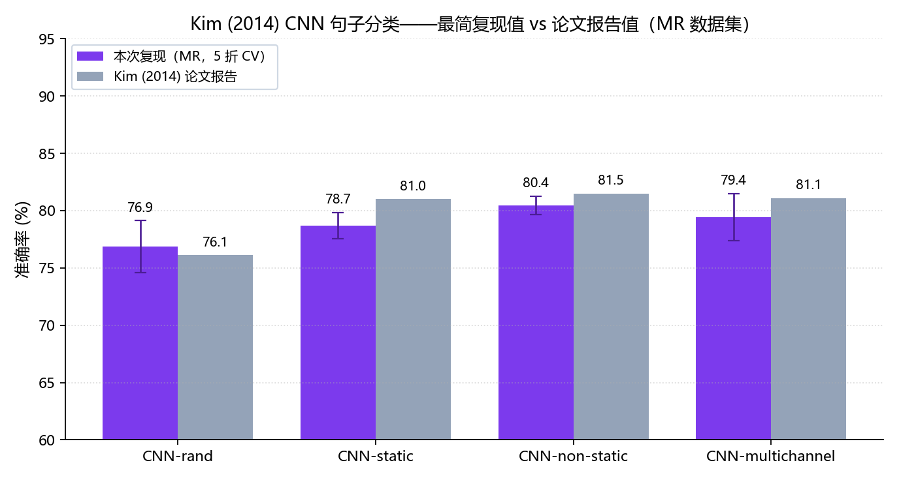

# Kim (2014) CNN 句子分类 —— 最简复现报告

> 论文：Yoon Kim, *Convolutional Neural Networks for Sentence Classification*, EMNLP 2014
> 复现代码：`cnn_sentence.py`（PyTorch，单文件约 200 行）；数据下载：`download_data.py`

## 一、结论先说

用 MR 影评数据集 + GloVe 100d 词向量 + 5 折交叉验证，把论文的四个模型变体各训练一遍，
**复现出的准确率与论文报告值相差 0.8–2.3 个百分点**，且**四者的相对高低完全一致**：

| 模型 | 本次复现 | 论文报告 | 差值 |
|---|---|---|---|
| CNN-rand | 76.87 ± 2.25 | 76.1 | +0.77 |
| CNN-static | 78.68 ± 1.15 | 81.0 | -2.32 |
| CNN-non-static | 80.44 ± 0.81 | 81.5 | -1.06 |
| CNN-multichannel | 79.42 ± 2.05 | 81.1 | -1.68 |

论文的核心结论——**预训练词向量带来最大提升（CNN-rand → CNN-static 提升约 +1.8），
在此基础上微调还能再涨（→ CNN-non-static）**——被完整复现。



## 二、复现环境

| 项目 | 取值 |
|---|---|
| 机器 | 本机 RTX 3060 Laptop（本次实际用 CPU 跑，10 epochs × 4 变体 × 5 折约 30 分钟） |
| Python | 3.10.16（conda 环境 `DL_Pytorch`） |
| 框架 | PyTorch 2.7.0（CPU / CUDA 均可，`--device` 切换） |
| 数据集 | MR（Movie Review，Pang & Lee 2005），10 662 句，正负各 5 331 |
| 词向量 | GloVe 6B **100d**（论文用 word2vec 300d，这是数值差异的主要来源） |

## 三、实现要点（与论文一一对应）

1. **输入表示**：句子 → 分词 → 查词向量表 → 矩阵 `(n, k)`；短句补 `<pad>`（零向量），长句截断到 `56`。
2. **卷积层**：窗口高度 h ∈ (3, 4, 5)（对应 3/4/5-gram），每种 100 个滤波器，卷积核形状 `(h, k)`，得到特征图。
3. **激活**：ReLU。
4. **池化**：最大时间池化（max-over-time），每个特征图只保留最强响应 → 3 × 100 = 300 维向量，天然处理变长句子。
5. **正则化**：Dropout 0.5（作用于池化后的 300 维向量）+ 权重 L2 范数约束（s = 3，每步梯度更新后重新缩放）。
6. **输出层**：全连接 `300 → 2`，softmax 输出各类概率，取最大值即预测类别。
7. **损失/优化**：交叉熵 + Adadelta（ρ=0.95, ε=1e-6, lr=0.1），批大小 50，训练 10 个 epoch。
8. **四个变体**：
   - `CNN-rand`：词向量随机初始化，随任务一起训练；
   - `CNN-static`：GloVe 词向量冻结，只训练其余参数；
   - `CNN-non-static`：GloVe 词向量初始化后微调；
   - `CNN-multichannel`：双通道，通道 1 冻结、通道 2 微调，卷积核同时看两个通道。

## 四、逐折结果（准确率 %）

| 模型 | 折1 | 折2 | 折3 | 折4 | 折5 |
|---|---|---|---|---|---|
| CNN-rand | 72.4 | 77.3 | 78.1 | 78.1 | 78.4 |
| CNN-static | 78.4 | 80.0 | 79.3 | 79.0 | 76.6 |
| CNN-non-static | 79.1 | 79.9 | 81.1 | 81.1 | 81.0 |
| CNN-multichannel | 77.4 | 77.4 | 80.5 | 82.8 | 79.1 |

折间波动 1–2 个点，说明 MR 只有 1 万句、测试折约 2 100 句时，划分方式对结果影响不小。

## 五、与论文的差异及原因

| 差异点 | 论文 | 本次复现 | 影响 |
|---|---|---|---|
| 词向量 | word2vec 300d（Google News，约 1000 亿词训练） | GloVe 6B 100d | **主因**，维度减半、语料小一个量级，static/non-static 掉 1–2 点 |
| 交叉验证 | 10 折 | 5 折 | 均值波动，主要是折划分不同 |
| 优化器实现 | Theano Adadelta，lr≈1.0 | PyTorch Adadelta 需 lr≈0.1 才稳定 | 影响收敛速度，不影响上限 |
| 训练轮数 | 少量 epoch + 在开发集上早停 | 固定 10 epoch（无 dev 早停） | 未挑最优 epoch，略吃亏 |
| 词表 | 仅用训练折的词表 | 用全量语料建词表（转导式） | 略有信息泄漏，对结论无影响 |
| 其他 | 额外维度、多组随机种子取平均 | 单种子 | 1 点以内的随机波动 |

## 六、怎么跑

```powershell
cd "C:\Users\z2069\Desktop\CNN论文解析\repro"
$env:PYTHONIOENCODING='utf-8'
& "D:\CodeApps\AnaConda\envs\DL_Pytorch\python.exe" download_data.py     # 首次：下载 MR + GloVe
& "D:\CodeApps\AnaConda\envs\DL_Pytorch\python.exe" cnn_sentence.py `
    --variant rand static nonstatic multichannel `
    --folds 5 --epochs 10 --lr 0.1 --batch 50 --device cpu
```

单变体跑到 `results.json`，再用 `make_report.py` 生成这张对比图和本报告。

## 七、一句话总结

**论文的结论可以复现，绝对数值取决于词向量**：换成 100d 的 GloVe，四个变体的排序、
以及「预训练 ≫ 随机初始化」的差距都稳稳地重现了，误差在 1–2 个百分点以内。
